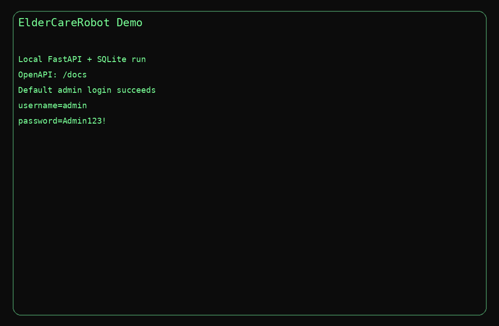

# ElderCareRobot Secure Simulation Backend

> A security-focused FastAPI backend prototype for simulated elder-care workflows — with consent-aware access, auditable actions, and verifiable alert evidence.



**Explore the project:** [Run locally](#exact-run-steps) · [Access and consent](#what-the-api-enforces) · [Try the CLI demo](#quick-demo-via-cli) · [Verify evidence](#evidence-pack-integrity) · [Security limitations](#security-notes-and-tradeoffs)

## Security at a glance

| Area | Demonstrated behavior |
| --- | --- |
| **Identity and access** | JWT authentication, role-based permissions for admin, relative, and provider, and patient-user linking checks |
| **Privacy by consent** | API-level redaction and visibility controls for location, interactions, adherence, and incidents |
| **Simulation and response** | Deterministic event simulation, rule-based warnings and critical alerts |
| **Accountability** | Append-only API audit records, including denied authenticated requests |
| **Evidence integrity** | Critical alert evidence packs with SHA-256 hashes and HMAC verification |
| **Local development** | Docker Compose, Python 3.11, and FastAPI Swagger/OpenAPI |

> [!IMPORTANT]
> The seeded `admin` / `Admin123!` login below is for **local demonstration only**. Do not expose this prototype publicly with development credentials or keys.

## Stack
- Python 3.11
- FastAPI
- SQLAlchemy
- SQLite
- Docker Compose

## Project structure
```text
eldercarerobot_backend/
├── app/
│   ├── main.py
│   ├── auth.py
│   ├── rbac.py
│   ├── models.py
│   ├── db.py
│   ├── simulation.py
│   ├── alerts.py
│   ├── audit.py
│   ├── evidence.py
│   └── schemas.py
├── scripts/
│   ├── demo_cli.py
│   └── verify_pack.py
├── data/
├── Dockerfile
├── docker-compose.yml
├── requirements.txt
└── README.md
```

## Exact run steps
### Option A: Docker Compose
From the project root:

```bash
docker compose up --build
```

The API will be available at:
- Swagger UI: `http://localhost:8000/docs`
- OpenAPI JSON: `http://localhost:8000/openapi.json`
- Health: `http://localhost:8000/health`

Default seeded admin account:
- username: `admin`
- password: `Admin123!`

### Option B: Run locally without Docker
```bash
python -m venv .venv
source .venv/bin/activate
pip install -r requirements.txt
uvicorn app.main:app --host 0.0.0.0 --port 8000
```

## Demo assets included
- terminal demo GIF: `demo.gif`
- example demo evidence pack JSON: `demo/evidence_pack_demo.json`
- CLI walkthrough script: `scripts/demo_cli.py`

## What the API enforces
### Authentication and RBAC
- `admin`
  - create users
  - create patients
  - set consents
  - link users to patients
  - simulate events
  - view audit logs
- `relative`
  - read linked patient status, events, and visible alerts
  - cannot acknowledge or resolve alerts
  - cannot add notes
- `provider`
  - read linked patient status, visible alerts, and visible events
  - add notes for linked patients
  - acknowledge alerts
  - resolve alerts

### Consent controls
Per patient, the admin can set:
- `location_visibility`
- `interaction_visibility`
- `adherence_visibility`
- `incidents_visibility`

Consent is enforced for non-admin users.
Examples:
- when `location_visibility=false`, room names and coordinates are redacted and location-driven alerts such as night wandering are hidden
- when `interaction_visibility=false`, interaction logs and assistant summaries are omitted
- when `adherence_visibility=false`, medication events are not returned
- when `incidents_visibility=false`, incident events such as falls are not returned

### Audit logging
Every authenticated request appends an audit entry with:
- actor user id and role
- endpoint and HTTP method
- timestamp
- patient scope where available
- allow or deny decision
- reason, such as `authorized`, `role_blocked`, `patient_link_blocked`, `consent_blocked`, or `login_success`
- HTTP status code

The audit log is append-only through the API. No delete endpoint exists.

### Alert rules implemented
- `medication_missed` twice within 24h -> `warning`
- `fall_suspected` not resolved within 2 virtual minutes -> `critical`
- `wandering_night` lasting more than 10 virtual minutes -> `warning`
- `wandering_night` plus `no_response` during the wandering window -> `critical`

### Evidence pack integrity
For critical alerts:
- `GET /alerts/{id}/evidence-pack` returns
  - alert metadata
  - included event payloads
  - `content_hash` as SHA-256 over canonical JSON
  - `signature` as HMAC-SHA256 over the content hash
- `POST /verify-evidence-pack` recomputes integrity and returns valid or invalid
- `scripts/verify_pack.py` verifies a saved evidence pack locally

## Suggested test flow in Swagger
1. `POST /auth/login` with `admin` / `Admin123!`
2. Use the returned bearer token with the Authorize button in Swagger
3. `POST /users` to create one `relative` and one `provider`
4. `POST /patients`
5. `POST /patients/{id}/link-user` twice
6. `POST /patients/{id}/consents`
7. `POST /patients/{id}/simulate?seed=123&hours=24`
8. log in as the relative and provider in separate sessions or via curl
9. verify:
   - relative can read status and alerts for linked patient only
   - relative cannot `POST /alerts/{id}/ack`
   - provider can add notes and acknowledge or resolve alerts
   - consent settings redact or hide sensitive data
   - `/audit-logs` grows after each authenticated call
   - `/alerts/{id}/evidence-pack` verifies with `/verify-evidence-pack`

## Quick demo via CLI
Run the API first, then:

```bash
BASE_URL=http://localhost:8000 OUTPUT_DIR=./demo python scripts/demo_cli.py
```

This script:
- creates a relative, provider, and patient
- links users to the patient
- applies restrictive consent
- simulates 24 hours of events
- shows admin seeing more alerts than relatives/providers because wandering is hidden when location consent is off
- shows relative denial on alert acknowledgement
- shows provider acknowledgement, note creation, evidence pack retrieval, integrity verification, and alert resolution
- dumps `demo/evidence_pack_demo.json`

## Example curl snippets
### Login
```bash
curl -s -X POST http://localhost:8000/auth/login \
  -H 'Content-Type: application/json' \
  -d '{"username":"admin","password":"Admin123!"}'
```

### Simulate a patient timeline
```bash
curl -s -X POST "http://localhost:8000/patients/1/simulate?seed=123&hours=24" \
  -H "Authorization: Bearer <ADMIN_TOKEN>"
```

### Read patient status
```bash
curl -s http://localhost:8000/patients/1/status \
  -H "Authorization: Bearer <USER_TOKEN>"
```

### Verify an evidence pack payload
```bash
curl -s -X POST http://localhost:8000/verify-evidence-pack \
  -H 'Content-Type: application/json' \
  -d @demo/evidence_pack_demo.json
```

### Offline verification script
```bash
python scripts/verify_pack.py demo/evidence_pack_demo.json
```

## Security notes and tradeoffs
- SQLite is used deliberately to keep the assignment local and reproducible.
- JWT uses a simple key ring. The active key is selected by `JWT_ACTIVE_KID` and verification supports all configured keys in `JWT_KEYRING_JSON` or the default dev key.
- Login rate limiting is intentionally lightweight and in-memory to avoid paid services.
- Evidence packs use deterministic canonical JSON hashing and an HMAC signature for integrity and authenticity inside a local deployment model.
- The audit log is append-only at the API surface, but this prototype does not implement tamper-evident database-level immutability.

## Improvements I would do next
- move from SQLite to PostgreSQL with immutable audit storage and row-level security
- add database migrations via Alembic
- add full automated tests around consent redaction and alert generation edge cases
- introduce refresh tokens and stronger session management
- add structured logging and metrics export
- add stronger evidence-pack signing with asymmetric keys and key rotation workflow
